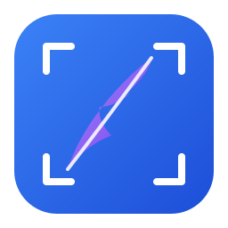
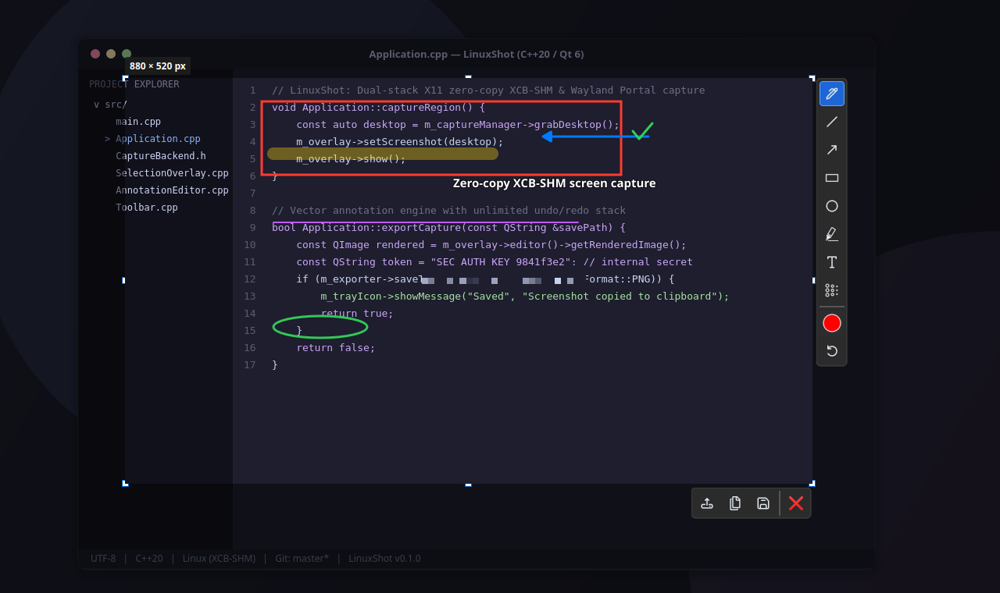
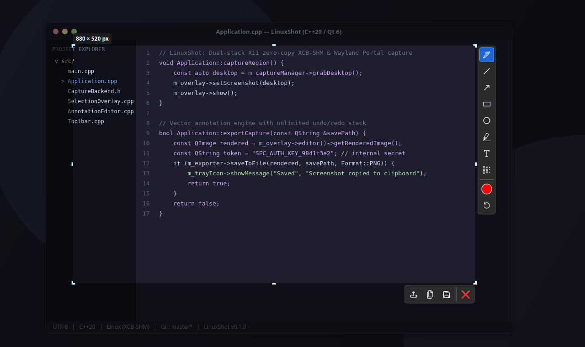
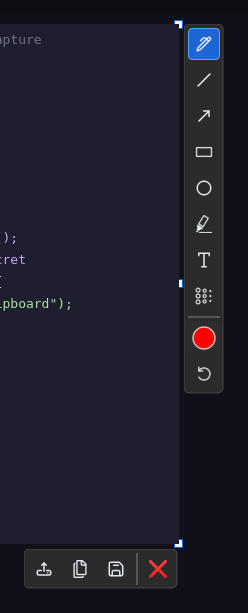
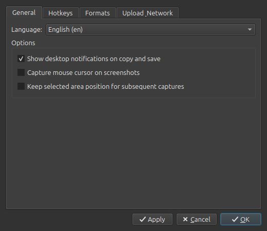
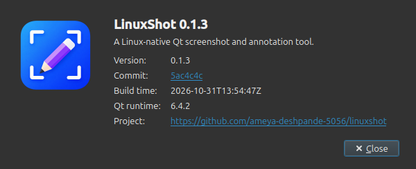

<div align="center">

  

  # LinuxShot

  **A fast, native Linux screenshot and interactive on-screen annotation tool.**

  *Intuitive region capture, real-time vector annotations, zero-copy X11 capture, and transparent Wayland portal integration.*

  <p align="center">
    <a href="https://en.cppreference.com/w/cpp/20"></a>
    <a href="https://www.qt.io/"></a>
    <a href="https://kernel.org/"></a>
    <a href="https://wayland.freedesktop.org/"></a>
    <a href="https://cmake.org/"></a>
    <a href="LICENSE"></a>
  </p>

  <p align="center">
    <a href="#screenshots">Screenshots</a> •
    <a href="#features">Features</a> •
    <a href="#technologies-used">Technologies Used</a> •
    <a href="#installation--packages">Installation</a> •
    <a href="#building-from-source">Building</a> •
    <a href="#usage--shortcuts">Usage & Shortcuts</a> •
    <a href="#documentation">Documentation</a>
  </p>

</div>

---

## Overview

**LinuxShot** is a clean-room, native Linux desktop application inspired by the fast, frictionless capture-and-annotate experience of Lightshot. Engineered from scratch with modern **C++20** and **Qt 6**, LinuxShot delivers instant multi-monitor screen acquisition, an interactive region selection overlay with 8 resize handles, on-the-fly vector drawing tools with unlimited undo/redo, and direct export to the clipboard, file system, or remote upload providers.

<p align="center">
  
</p>

---

## Screenshots

### 1. Interactive Region Selection & Floating Toolbars
Full-screen multi-monitor capture with darkened scrim, dynamic dimension badge (`880 × 520 px`), 8 interactive resize handles, and real-time floating toolbars.

<p align="center">
  
</p>

### 2. On-Screen Vector Annotation Engine
Comprehensive vector drawing suite featuring directional arrows, rectangles, circles, semi-transparent highlighter (marker), text typography callouts, straight lines, freehand pen strokes, and privacy blur/pixelate.

<p align="center">
  
</p>

### 3. Floating Tool & Action Palettes
Dual floating palettes docking to selection boundaries: vertical annotation palette (tools, color swatch, undo) and horizontal action palette (Upload, Copy, Save, Cancel).

<p align="center">
  
</p>

### 4. Preferences & Settings
Tabbed configuration dialog with persistent XDG storage (`~/.config/linuxshot/linuxshot.conf`) managing desktop notifications, global shortcuts, format encoders (PNG/JPEG/BMP) with quality tuning, custom self-hosted endpoints, and an optional public Lightshot (`prnt.sc`) upload provider with security warning disclaimer.

<p align="center">
  
</p>

### 5. About LinuxShot Dialog
Native dark-themed metadata dialog displaying the application logo, version, clickable Git commit hash, build timestamp, and Qt runtime environment.

<p align="center">
  
</p>

---

## Features

- 📐 **Interactive Region Capture**:
  - Full-screen and draggable bounding-box selection.
  - 8 resize handles with real-time toolbar tracking during drag/resize operations.
  - Dimension badge display showing precise selection width and height.
- 🎨 **8 Vector Annotation Tools**:
  - **Pen**: Smooth freehand vector pencil.
  - **Line**: Straight line with angle snapping.
  - **Arrow**: Directional pointer with sharp arrowhead.
  - **Rectangle**: Hollow bounding box outline.
  - **Circle / Ellipse**: Smooth rounded outline.
  - **Marker / Highlighter**: Semi-transparent highlighter with alpha blending.
  - **Text**: Interactive inline draggable text box with on-canvas editing, fixed-width word-wrapping, dynamic multi-line height expansion, and click-outside commitment.
  - **Blur / Pixelate**: Privacy blur and pixelation brush.
- ↺ **Command History**: Full Undo (`Ctrl+Z`) and Redo (`Ctrl+Y`) vector action stack.
- ⚡ **Dual Capture Engine**:
  - **X11**: Zero-copy **XCB-SHM** (Shared Memory) frame acquisition.
  - **Wayland**: Transparent D-Bus **XDG Desktop Portal** (`org.freedesktop.portal.Screenshot`) fallback.
- 💾 **Export & Sharing**:
  - Save to **PNG**, **JPEG**, and **BMP** with automatic file naming.
  - One-click copy to system clipboard (`Ctrl+C`).
  - Pluggable asynchronous upload engine with self-hosted server support and optional Lightshot (`prnt.sc`) public upload toggle.
- 🖥️ **Desktop Integration**:
  - System tray icon with quick actions and persistent preferences dialog.
  - Modern dark-themed "About LinuxShot" dialog displaying version, Git commit hash, build timestamp, and Qt runtime metadata.
  - Global hotkeys (`Print Screen`, `Shift+Print Screen`).
  - Self-contained SVG UI icons with dynamic dark-mode tinting.
  - Multi-monitor awareness and native High-DPI scaling.
  - XDG-compliant persistent configuration (`~/.config/linuxshot/linuxshot.conf`).

---

## Technologies Used

| Technology | Purpose | Description |
|:---|:---|:---|
| **C++20** | Core Language | Structured concurrency, modern standard library algorithms, RAII, and type safety. |
| **Qt 6** | UI & Application Framework | `QtWidgets`, `QtGui`, `QtSvg`, `QtNetwork`, and `QtDBus` for modern Linux desktop integration. |
| **XCB / XCB-SHM** | X11 Capture & Shortcuts | Zero-copy shared-memory frame transfer and root window global shortcut grabber. |
| **XDG Desktop Portal** | Wayland Capture | D-Bus screen capture interface compatible with GNOME, KDE Plasma, wlroots, and Sway. |
| **CMake & CTest** | Build & Test System | Modern modular CMake build configuration and automated test suite. |
| **AppImage & dpkg** | Packaging | Standalone portable AppImage binaries and standard Debian (`.deb`) packages. |
| **GitHub Actions** | CI / CD Automation | Continuous integration and changelog-driven automated releases. |

---

## Installation & Packages

### Debian / Ubuntu (`.deb`)

Download the latest `.deb` package from the [Releases](https://github.com/ameya-deshpande-5056/linuxshot/releases) page and install:

```bash
sudo dpkg -i linuxshot_0.1.3_amd64.deb
sudo apt-get install -f # resolve any runtime dependencies if prompted
```

### Standalone AppImage

Download the executable `.AppImage` from [Releases](https://github.com/ameya-deshpande-5056/linuxshot/releases), make it executable, and run:

```bash
chmod +x LinuxShot-0.1.3-x86_64.AppImage
./LinuxShot-0.1.3-x86_64.AppImage
```

---

## Building from Source

### Prerequisites

Install required development packages on Ubuntu / Debian:

```bash
sudo apt-get update
sudo apt-get install -y \
  build-essential \
  cmake \
  qt6-base-dev \
  libqt6svg6-dev \
  libxcb1-dev \
  libxcb-shm0-dev \
  libxcb-keysyms1-dev \
  libx11-dev \
  squashfs-tools
```

### Using Helper Scripts (Recommended)

LinuxShot provides one-line scripts to automate building, testing, installing, and uninstalling:

```bash
# 1. Compile and run test suite
./scripts/build.sh

# 2. Install binary, desktop entry, and icons to /usr/local
sudo ./scripts/install.sh

# 3. Uninstall from the system (optional --purge to remove ~/.config/linuxshot)
sudo ./scripts/uninstall.sh
```

### Manual CMake Build & Install

```bash
# Clone the repository
git clone https://github.com/ameya-deshpande-5056/linuxshot.git
cd linuxshot

# Configure and compile in Release mode
cmake -B build -DCMAKE_BUILD_TYPE=Release -DBUILD_TESTS=ON
cmake --build build -j$(nproc)

# Run test suite
ctest --test-dir build --output-on-failure

# Install to system
sudo cmake --install build

# Uninstall from system
sudo cmake --build build --target uninstall
```

### Generate Packages Locally

```bash
# Build Debian package (.deb)
./packaging/build-deb.sh 0.1.3

# Build AppImage (.AppImage)
./packaging/build-appimage.sh 0.1.3
```

---

## Usage & Shortcuts

Launch LinuxShot from your desktop application launcher or run:

```bash
linuxshot
```

### Default Shortcuts

| Action | Shortcut | Description |
|:---|:---|:---|
| **Capture Region** | `Print Screen` | Spawns fullscreen selection overlay |
| **Fullscreen Capture** | `Shift + Print Screen` | Captures entire virtual desktop across all monitors |
| **Save Image** | `Ctrl + S` | Opens file chooser to save image (PNG/JPEG/BMP) |
| **Copy to Clipboard** | `Ctrl + C` | Copies current cropped screenshot to clipboard |
| **Undo Annotation** | `Ctrl + Z` | Reverts the last vector drawing action |
| **Redo Annotation** | `Ctrl + Y` | Re-applies the previously reverted action |
| **Commit Text Box** | `Ctrl + Enter` / Click outside | Bakes active inline text box into the vector annotations |
| **Reposition Text Box** | Drag border / `Alt + Drag` | Moves active text box across screenshot without headers |
| **Cancel Capture** | `Escape` | Dismisses active text box or closes selection overlay |

---

## Documentation

- [`AGENTS.md`](AGENTS.md) — Comprehensive architecture invariants, coding rules, and the strict release protocol for automated agents and developers.
- [`ARCHITECTURE.md`](ARCHITECTURE.md) — Detailed software design specification, module boundaries, and subsystem lifecycles.
- [`CHANGELOG.md`](CHANGELOG.md) — Keep a Changelog compliant release history.
- [`PROJECT_STATUS.md`](PROJECT_STATUS.md) — Implementation phase status and testing breakdown.

---

## License

This project is licensed under the **GNU General Public License v3.0 or later** — see the [LICENSE](LICENSE) file for details.
